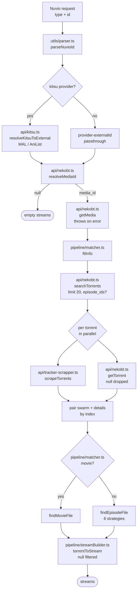

# Project Context

This is a Nuvio addon that uses the NekoBT API to find anime torrents
matching Nuvio requests.

Core pipeline:

```text
Nuvio input
  → media resolution
  → torrent discovery (multiple torrents)
  → file selection (per torrent)
  → stream construction
  → Nuvio response
```

Torrent selection and file selection are separate operations: a torrent may
contain multiple episodes, seasons, or a complete series — identify the
requested video from the torrent's file list rather than assuming
one torrent = one episode (see `test/data/unsupported/self-stream/meta.json`).

Prefer existing project architecture and conventions over introducing
new abstractions. Do not make unrelated changes.

## Module Map



| Path | Purpose |
| :--- | :--- |
| `src/app.ts` | Express app + route handlers (supertest seam); thin `src/index.ts` only calls `startServer()` |
| `src/api/kitsu.ts` | Kitsu mappings → MAL/AniList external ID |
| `src/api/nekobt.ts` | Typed NekoBT client (`resolveMediaId`, `getMedia`, `searchTorrents`, `getTorrent`) |
| `src/api/tracker-scrapper.ts` | BitTorrent tracker scrape → live seed/peer counts |
| `src/pipeline/matcher.ts` | `fitInfo` + file matching via 6 ordered strategies |
| `src/pipeline/streamBuilder.ts` | Stream objects with metadata badges + swarm info |
| `src/utils/parser.ts` | Nuvio stream request parsing |
| `src/utils/format.ts` | File sizes, bitrates, language tags |
| `src/utils/logger.ts` | Level-filtered logger (`LOG_LEVEL`) |
| `src/environment.ts` | Runtime config (port, build info) |
| `src/types.ts` | Shared interfaces (owns nothing; distribution planned in design-review) |

## Environment Variables

| Variable | Default | Purpose |
| :--- | :--- | :--- |
| `PORT` | `7000` | Port for the HTTP server |
| `LOG_LEVEL` | `info` | Logging verbosity (`debug`, `info`, `warn`, `error`, `off`) |
| `STALENESS_DAYS` | `14` | Test-data freshness threshold (warning-only) |

## Test Fixtures & Samples

Test data lives under `test/data/` — the first three folders hold **real** data:

- `fixtures/` — immutable justification evidence (payload `<id>.json` + records-only `meta.json`); a specific real case, pointed at by at least one test
- `examples/` — refreshable portrait of observed requests; used **as a whole** (the corpus drives the matcher and API tests; no data point picked out); `self-stream/` holds the observed Nuvio stream requests — not an exhaustive catalog
- `unsupported/` — quarantine for known-broken cases (excluded from vitest collection)
- `synthetic/` — assumed, ungrounded shapes — never passed off as real; a specific assumed shape, pointed at by one test as a rule of thumb

Folders are named `<service>-<api>`; endpoint declarations (`endpoint`/`key`/`defaults`) live in the root registry `test/data/meta.json`.

| Layer | Files | Runs |
|-------|-------|------|
| UNIT | `api/format/logger/matcher/metadata/parser/streamBuilder.test.ts` | mocked `fetch`/`tracker`; `loadFixture`/`loadFixtureData`+`loadSynthetic`; `matcher.test.ts` also drives the whole `examples/` corpus |
| INTEGRATION | `app.test.ts` | supertest; mocked `api/*`, real pipeline |
| INTEGRATION | `integration.test.ts` | the self-stream corpus replayed end to end — only the network is mocked (HTTP serves the catalog, UDP the tracker scrape) |

Maintenance scripts (`npm run test:*` — never wired into CI, no network in suite):
- `test:examples:refresh [-- --dry-run]` — re-fetch example payloads + update `fetched` dates (skips `self-stream/` snapshots and `tracker-scrape/`, which speaks UDP)
- `test:fixtures:compare` — always-live comparison of fixtures vs registry; reports shape diffs for human triage, never writes
- `test:data:check` — data-integrity checks over the catalog (records ↔ payloads, cross-folder references, the shapes the code reads); run it when a data point is added or after a refresh

A staleness warning (`test/setup/staleness.ts`, wired via vitest `globalSetup` so it prints once per run) logs at startup if the *oldest* example `fetched` date exceeds `STALENESS_DAYS` (default 14); the warning path is covered by `test/setup/staleness.test.ts`.

## NekoBT Domain Knowledge

For NekoBT-specific details, refer to the NekoBT skill located at `.agents/skills/nekobt/SKILL.md`.
