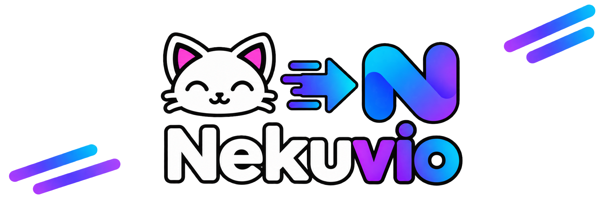

# Nekuvio

<div align="center">

</div>

---

<div align="center">

[](https://github.com/dormindev/Nekuvio/actions/workflows/ci.yml)
[](https://codecov.io/gh/dormindev/Nekuvio)

[](https://github.com/dormindev/Nekuvio/actions/workflows/release.yml)
[](https://github.com/dormindev/Nekuvio/pkgs/container/nekuvio)
[](https://github.com/dormindev/Nekuvio/releases/latest)

</div>


## Description
Nekuvio is a [Nuvio](https://github.com/tapframe/Nuvio) addon that acts as a bridge to [NekoBT](https://www.nekobt.to/), resolving anime metadata requests to torrent streams.

### Pipeline Overview

```
Nuvio Request
  → Media Resolution (Kitsu / MAL / IMDb / TVDB / etc.)
  → Torrent Discovery (NekoBT API)
  → File Selection (multi-strategy episode matcher)
  → Stream Construction (metadata enrichment & tracker scrape)
  → Nuvio Response
```

## Usage

Nekuvio is distributed as a Docker container image via GitHub Packages.

### Quick Start with Docker Compose

This repository ships a `compose.yaml` that builds the image from source:

```bash
docker compose up -d
```

To run the published image instead, see [docs/docker.md](docs/docker.md).

Once running, configure the addon in your Nuvio client using your server URL (e.g. `http://<your-ip>:7000/manifest.json`).

For full configuration options and environment variable references, see [docs/docker.md](docs/docker.md).

## Development

### Prerequisites

[](https://nodejs.org)
[](https://www.npmjs.com)
[](https://www.typescriptlang.org)

### Quick Start

Clone the repository with submodules:

```bash
git clone --recurse-submodules https://github.com/dormindev/Nekuvio.git
cd Nekuvio
```

Install dependencies:

```bash
npm ci
```

Build and run:

```bash
npm run build
npm start
```

For complete development workflow, testing, and debugging commands, see [docs/development.md](docs/development.md).

## Documentation

* [Documentation Index](docs/README.md) - Guides, references, and architecture overview
