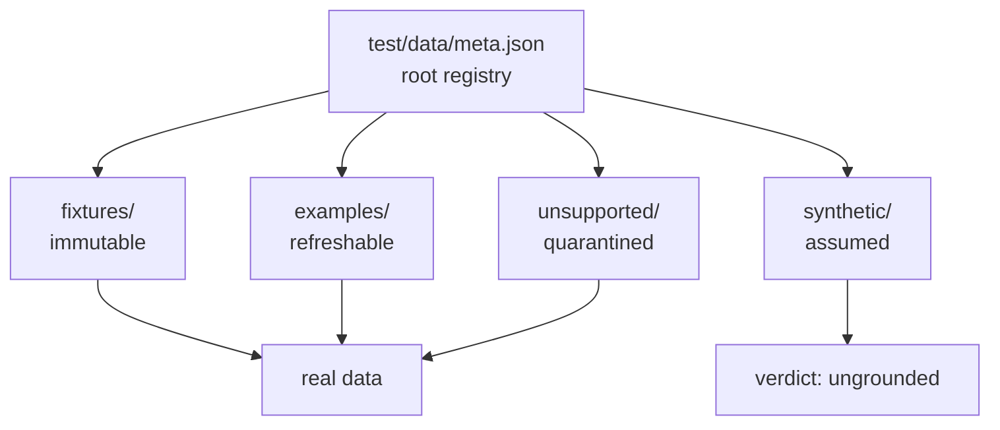

# Nekuvio Data Catalog

**Generated:** 2026-10-19 · **Status:** step 04 complete
**Purpose:** evidence base for `test/data/` — one entry per interesting real-world case per external endpoint (Kitsu mappings, NekoBT resolve/media/search/torrents, tracker scrape) plus our own `/stream`. Every entry grounds a type or behavior in observed reality.

## How to read this catalog

- **One section per endpoint**, matching a `test/data/<folder>/` path (`<service>-<api>`).
- Each entry: `endpoint`, `ids observed`, `params` (exact values), `fetched` (capture date), `location` (file under `test/data/`), `edge` (what distinguishes it), `grounds` (code path it justifies), `motivated change`.
- **Standing = folder:** `fixtures/`+`examples/` real · `unsupported/` known-broken · `synthetic/` assumed-unverified. No status field.
- **`fetched: null`** = not refreshable (self-stream behavior snapshots). Fixtures carry a real `fetched` date — the day they were captured — and are immutable thereafter.
- **Raw storage:** every payload is stored exactly as the endpoint answered it (NekoBT: `{ error, data }`; Kitsu: `{ data, meta, links }`). No folder flattens the envelope — `fixtures/`, `examples/` and `synthetic/` are shape-identical for a given endpoint.
- **Season-0 requests arrive as `tt<id>:0:<ep>`.** Observed empirically for every special/movie request from an anime franchise: Nuvio sends an **imdb** id with **season 0**, never an anime-provider id. That is why the anime-provider branch skips season-0 entries — such a request never reaches it. The season-0 path is the non-anime branch, and the catalog's season-0 media (Attack on Titan's 13 specials) exercise it.
- **`used_by`** — the self-stream records a data point was an input for. The linkage is *reverse* (the input names the record), so it survives a data point being promoted between `examples/` and `fixtures/`. Two derivations fill it in: the media of a record follows from its resolve example's `media_id`, and the torrents of a record are the results its search example returned. `npm run test:data:check` asserts every self-stream record is closed.
- **Catalog integrity** — `npm run test:data:check` validates the *catalog*, not the code, in five groups:
  - **references** — a torrent's `media_id` and `media_episode_ids` resolve to media we hold; a search's results are torrents we hold; a resolve's `media_id` is a media we hold
  - **shapes the code reads** — a torrent's magnet carries its own `infohash`, it has at least one video file, an `anilist` entry carries its `media.title`, a resolve payload without an error carries a `media_id`, a resolve payload without an error carries a `media_id`
  - **Kitsu** — a mapping's `links.self` points at that mapping, and its `externalSite` is from the known vocabulary
  - **the self-stream linkage** — every record has a resolve input, its streams never outnumber its torrents, a record without torrents says so in its `grounds`, and a record with streams has a media input
  - **structure** — every record has its payload file

  Run it when a data point is added, when assumptions change, or after a refresh.
- **The three standings, three roles:** a **fixture** is a specific real case, pointed at by at least one test; a **synthetic** is a specific assumed shape, pointed at by one test as a rule of thumb; **`examples/` are used as a whole** — the matcher test drives every torrent in the corpus through the real matcher, rebuilding the fit info from the torrent's own `media_episode_ids` and the media they belong to. No data point is picked out; a test that needs a specific example promotes it to a fixture first.
- Every payload has a matching `meta.json` record.

## Endpoint inventory & coverage

### Kitsu mappings — `GET /anime/<id>/mappings`

Registry node: `kitsu.apis.mappings` (`test/data/meta.json`).  
Folders: `examples/kitsu-mappings/`, `fixtures/kitsu-mappings/`, `synthetic/kitsu-mappings/`.

| Entry | ids observed | params | fetched | location | edge | grounds | motivated change |
|-------|-------------|--------|---------------|----------|------|---------|------------------|
| kitsu 49235 → MAL 59970 + AniList | `49235` | `{ path: { id: "49235" } }` | 2026-10-19 | `fixtures/kitsu-mappings/49235.json` + `examples/kitsu-mappings/49235.json` | canonical MAL-preferred resolution used by `resolveKitsuToExternal`; also the self-stream seed `series-kitsu_49235_24` | Kitsu mappings input for `series-kitsu_49235_24`; justifies `kitsu.ts` provider ordering (MAL first, AniList fallback) | none |
| kitsu 12 → MAL + AniList | `12` | `{ path: { id: "12" } }` | 2026-10-19 | `examples/kitsu-mappings/12.json` | `series-kitsu_12_1180` input | kitsu mappings input for `series-kitsu_12_1180` | none |
| kitsu 11794 → MAL + AniList | `11794` | `{ path: { id: "11794" } }` | 2026-10-19 | `examples/kitsu-mappings/11794.json` | `series-kitsu_11794_1` input | kitsu mappings input for `series-kitsu_11794_1` | none |
| kitsu 12566 → MAL + AniList | `12566` | `{ path: { id: "12566" } }` | 2026-10-19 | `examples/kitsu-mappings/12566.json` | `series-kitsu_12566_1` input | kitsu mappings input for `series-kitsu_12566_1` | none |
| kitsu 3919 → MAL + AniList | `3919` | `{ path: { id: "3919" } }` | 2026-10-19 | `examples/kitsu-mappings/3919.json` | `series-kitsu_3919_1` input; part of the known-broken Bakemonogatari case | kitsu mappings input for `series-kitsu_3919_1` | none |
| kitsu 51128 → AniList only (no MAL) (fixture) | `51128` | `{ path: { id: "51128" } }` | 2026-10-19 | `fixtures/kitsu-mappings/51128.json` | **anilist-only fallback** — `data` array contains `anilist/anime` but no `myanimelist/anime` | grounds `kitsu.ts` providers fallback (throws when no useful mapping) | none |
| kitsu 452 → TVDB/AnidB only (no MAL/AniList) | `452` | `{ path: { id: "452" } }` | 2026-10-19 | `examples/kitsu-mappings/452.json` | **no MAL/AniList mapping** — TVDB/AnidB only; `data` has neither provider the code looks for | grounds `kitsu.ts` providers fallback for non-anime IDs (throws when no useful mapping) | none |

**Ungrounded:** empty/non-array `data` from Kitsu mappings — the code defends against it (`Array.isArray(data?.data) ? data.data : []`) but no live case confirms it. Records + assumed payloads under `test/data/synthetic/kitsu-mappings/` (`empty-mappings`, `null-data`), migrated from `api.test.ts`.

### NekoBT resolve — `GET /media/resolve`

Registry node: `nekobt.apis.resolve`.  
Folder: `examples/nekobt-resolve/`.

| Entry | ids observed | params | fetched | location | edge | grounds | motivated change |
|-------|-------------|--------|---------------|----------|------|---------|------------------|
| IMDB tt0434665 → s2999, anilist null | `imdb-tt0434665` | `{ query: { id: "imdb-tt0434665" } }` | 2026-10-19 | `examples/nekobt-resolve/imdb-tt0434665.json` | series prefix `s`, `anilist_id: null` whole-series form | resolve input for `series-tt0434665_0_6` / `_0_99` | none |
| IMDB tt12415546 → m1199, anilist null | `imdb-tt12415546` | `{ query: { id: "imdb-tt12415546" } }` | 2026-10-19 | `examples/nekobt-resolve/imdb-tt12415546.json` | movie prefix `m`, `anilist_id: null` | resolve input for `movie-tt12415546` | none |
| IMDB tt12728856 → s11629, anilist null | `imdb-tt12728856` | `{ query: { id: "imdb-tt12728856" } }` | 2026-10-19 | `examples/nekobt-resolve/imdb-tt12728856.json` | series prefix `s`, `anilist_id: null` | resolve input for `series-tt12728856_0_4` | none |
| IMDB tt14523706 → **unresolvable** (error) | `imdb-tt14523706` | `{ query: { id: "imdb-tt14523706" } }` | 2026-10-19 | `examples/nekobt-resolve/imdb-tt14523706.json` | `error: true` — "No media found for that external ID." | exercise the `!result.response.ok \|\| result.data?.error → null` path in `resolveMediaId` | none |
| IMDB tt38652027 → s1008, anilist 178707 | `imdb-tt38652027` | `{ query: { id: "imdb-tt38652027" } }` | 2026-10-19 | `examples/nekobt-resolve/imdb-tt38652027.json` | series with populated `anilist_id` | resolve input for `movie-tt38652027` | none |
| IMDB tt5323662 → m145, anilist null | `imdb-tt5323662` | `{ query: { id: "imdb-tt5323662" } }` | 2026-10-19 | `examples/nekobt-resolve/imdb-tt5323662.json` | movie prefix `m`, `anilist_id: null` | resolve input for `movie-tt5323662` | none |
| IMDB tt5607616 → s554, anilist null | `imdb-tt5607616` | `{ query: { id: "imdb-tt5607616" } }` | 2026-10-19 | `examples/nekobt-resolve/imdb-tt5607616.json` | series prefix `s`, `anilist_id: null` | resolve input for `series-tt5607616_0_1` | none |
| IMDB tt6455986 → s1453, anilist null | `imdb-tt6455986` | `{ query: { id: "imdb-tt6455986" } }` | 2026-10-19 | `examples/nekobt-resolve/imdb-tt6455986.json` | series prefix `s`, `anilist_id: null` | resolve input for `series-tt6455986_0_1` | none |
| IMDB tt9054364 → s172, anilist null | `imdb-tt9054364` | `{ query: { id: "imdb-tt9054364" } }` | 2026-10-19 | `examples/nekobt-resolve/imdb-tt9054364.json` | series prefix `s`, `anilist_id: null` | resolve input for `series-tt9054364_0_14` | none |
| MAL 21 → s1545, anilist 21 | `mal-21` | `{ query: { id: "mal-21" } }` | 2026-10-19 | `examples/nekobt-resolve/mal-21.json` | `anilist_id` populated | resolve input for `series-kitsu_12_1180` | none |
| MAL 32615 → s1453, anilist 21613 | `mal-32615` | `{ query: { id: "mal-32615" } }` | 2026-10-19 | `examples/nekobt-resolve/mal-32615.json` | | resolve input for `series-tt6455986_0_1` | none |
| MAL 34134 → s843, anilist 97668 | `mal-34134` | `{ query: { id: "mal-34134" } }` | 2026-10-19 | `examples/nekobt-resolve/mal-34134.json` | | resolve input for `series-kitsu_12566_1` | none |
| MAL 5081 → s193, anilist 5081 | `mal-5081` | `{ query: { id: "mal-5081" } }` | 2026-10-19 | `examples/nekobt-resolve/mal-5081.json` | | resolve input for `series-kitsu_3919_1` | none |
| MAL 59970 → s172, anilist 182205 | `mal-59970` | `{ query: { id: "mal-59970" } }` | 2026-10-19 | `examples/nekobt-resolve/mal-59970.json` | `series-kitsu_49235_24` resolution chain (kitsu 49235 → mal 59970 → s172) | resolve input for `series-kitsu_49235_24` | none |
| MAL 64012 → m1064, anilist 211308 | `mal-64012` | `{ query: { id: "mal-64012" } }` | 2026-10-19 | `examples/nekobt-resolve/mal-64012.json` | movie prefix `m` | resolve input for `movie-mal_64012` | none |

**Coverage note:** `isMovie` is derived from the `media_id` prefix (`m` vs `s`) in `resolveMediaId`. All provider prefixes (`imdb-`, `mal-`) are covered.

### NekoBT media — `GET /media/<id>?force=true`

Registry node: `nekobt.apis.media` (defaults `{ force: "true" }`).  
Folders: `examples/nekobt-media/`, `fixtures/nekobt-media/`.

| Entry | ids observed | params | fetched | location | edge | grounds | motivated change |
|-------|-------------|--------|---------------|----------|------|---------|------------------|
| m1064 (movie) | `m1064` | `{ path: { id: "m1064" }, query: { force: "true" } }` | 2026-10-19 | `examples/nekobt-media/m1064.json` | movie; `anilist.primary` present, `episodes: []`, `entries=1` | media input for `movie-mal_64012` | none |
| m1199 (movie) | `m1199` | `{ path: { id: "m1199" }, query: { force: "true" } }` | 2026-10-19 | `examples/nekobt-media/m1199.json` | movie; `anilist: null`, `episodes: 0` | resolve input for `movie-tt12415546` | none |
| s1008 | `s1008` | `{ path: { id: "s1008" }, query: { force: "true" } }` | 2026-10-19 | `examples/nekobt-media/s1008.json` | 7 anilist entries, 62 episodes, seasons [0,1,2,3]; multi-cour with `dst_start`/`src_end` ranges | media input for `movie-tt38652027` | none |
| s11629 | `s11629` | `{ path: { id: "s11629" }, query: { force: "true" } }` | 2026-10-19 | `examples/nekobt-media/s11629.json` | entries=3, includes season-0 special range `src 13-14 → dst 1-2` | media input for `series-tt12728856_0_4` | none |
| s1453 | `s1453` | `{ path: { id: "s1453" }, query: { force: "true" } }` | 2026-10-19 | `examples/nekobt-media/s1453.json` | 4 entries, seasons [0,1,2] | media input for `series-tt6455986_0_1` | none |
| s1545 (fixture) | `s1545` | `{ path: { id: "s1545" }, query: { force: "true" } }` | 2026-10-19 | `fixtures/nekobt-media/s1545.json` | **62 entries, 1242 episodes** — the largest media in the corpus; season-0 special `src 25 → dst 1-2`; 16 entries carry an **empty `synonyms`** list | named-season matching without synonyms; the largest corpus for future cases | none |
| s193 (fixture) | `s193` | `{ path: { id: "s193" }, query: { force: "true" } }` | 2026-10-19 | `fixtures/nekobt-media/s193.json` | **21 entries, 122 episodes**, seasons [0..7]; season-0 special ranges `src 3-6 → dst 1-4` etc.; its **season 2 is Nisemonogatari**, a second series in the same integral release | media input for `series-kitsu_3919_1`; the season title that disambiguates the integral | none |
| s2999 | `s2999` | `{ path: { id: "s2999" }, query: { force: "true" } }` | 2026-10-19 | `examples/nekobt-media/s2999.json` | **26 entries, 423 episodes**; season ranges with `dst_start` offsets (e.g. season 2 `src 1-21 → dst 21-41`) | media input for `series-tt0434665_0_6` / `_0_99` | none |
| s554 | `s554` | `{ path: { id: "s554" }, query: { force: "true" } }` | 2026-10-19 | `examples/nekobt-media/s554.json` | 12 entries, 155 episodes, seasons [0..4]; season-0 special ranges | media input for `series-tt5607616_0_1` | none |
| s843 | `s843` | `{ path: { id: "s843" }, query: { force: "true" } }` | 2026-10-19 | `examples/nekobt-media/s843.json` | 6 entries, 53 episodes, seasons [0..3]; season-0 special range `src 2-7 → dst 1-6` | media input for `series-kitsu_12566_1` | none |
| m1305 | `m1305` | `{ path: { id: "m1305" }, query: { force: "true" } }` | 2026-10-19 | `examples/nekobt-media/m1305.json` | **`anilist: null`** — TMDB-resolved western animation; justifies `if (!media.anilist) return null` guard | null-anilist media (README §1) | `fitSeasonInfo` null-anilist guard |
| m884 | `m884` | `{ path: { id: "m884" }, query: { force: "true" } }` | 2026-10-21 | `examples/nekobt-media/m884.json` | **Bleach the Movie: Hell Verse** — a movie media with no episodes; the media that torrent `11409754265088` points at | the media behind a movie release | none |
| s11599 (fixture) | `s11599` | `{ path: { id: "s11599" }, query: { force: "true" } }` | — | `fixtures/nekobt-media/s11599.json` | **`anilist: null`** via TVDB resolution; `episodes: 4`, seasons [1] | null-anilist series (README §1) | `fitSeasonInfo` null-anilist guard |
| m145 (fixture) | `m145` | `{ path: { id: "m145" }, query: { force: "true" } }` | — | `fixtures/nekobt-media/m145.json` | movie; `anilist.primary` present | movie fixture table | none |
| s824 (fixture) | `s824` | `{ path: { id: "s824" }, query: { force: "true" } }` | 2026-10-21 | `fixtures/nekobt-media/s824.json` | **Attack on Titan** — 21 entries over 5 seasons, **13 season-0 specials** with scattered src windows (7, 12-13, 14, 15, 17, 18, 20-23, 24-30, 36-37), 17 src/dst offsets; season 1's title is exactly "Shingeki no Kyojin" (15 synonyms) | the anime-provider branch skipping season-0 specials; the named-season strategy | none |
| s679 (fixture) | `s679` | `{ path: { id: "s679" }, query: { force: "true" } }` | 2026-10-21 | `fixtures/nekobt-media/s679.json` | **Hunter x Hunter** — seasons numbered continuously (S1 dst 1-58, S2 dst 59-136, S3 dst 137-148, i.e. src ≠ dst); the only series found whose season-0 episodes still carry an `absolute` | absolute numbering continuing across seasons | none |
| s11509 (fixture) | `s11509` | `{ path: { id: "s11509" }, query: { force: "true" } }` | 2026-10-21 | `fixtures/nekobt-media/s11509.json` | **Naruto** — 13 entries over 6 seasons with **11 cour-split offsets** (S2 dst 36-83, S3 dst 84-131, S4 dst 132-179, S5 dst 180-220) and 9 distinct anilist ids | a season split across two anilist entries; absolute numbering across seasons | none |
| m517 (fixture) | `m517` | `{ path: { id: "m517" }, query: { force: "true" } }` | 2026-10-21 | `fixtures/nekobt-media/m517.json` | **Spirited Away** — a real movie: one anilist entry with `season: null` and a full title | movie media resolution | none |
| s172 (fixture) | `s172` | `{ path: { id: "s172" }, query: { force: "true" } }` | — | `fixtures/nekobt-media/s172.json` | multi-season anilist.entries + `src`/`dst` offsets | README §3 offset mapping | offset-mapping tests |

**Verified offset behavior:** `s1545` shows `dst_start` ≠ 1 multi-cour splits (e.g. season 2 `src 1-22 → dst 9-30`). `s172` season 4 maps `src 1-24 → dst 1-24` (no offset). Season-0 specials confirmed present across `s1008`, `s11629`, `s193`, `s2999`, `s554`, `s843`, `s1545`.

### NekoBT search — `GET /torrents/search`

Registry node: `nekobt.apis.search` (defaults `{ limit: "20" }`).  
Folders: `examples/nekobt-search/`, `synthetic/nekobt-search/`.

| Entry | ids observed | params | fetched | location | edge | grounds | motivated change |
|-------|-------------|--------|---------------|----------|------|---------|------------------|
| s172-220940 | `s172-220940` | `{ media_id: "s172", limit: "20", episode_ids: "220940" }` | 2026-10-19 | `examples/nekobt-search/s172-220940.json` | single episode; `more: true` (20 torrents) | search input for `series-kitsu_49235_24` | none |
| s1545-529267 | `s1545-529267` | `{ media_id: "s1545", limit: "20", episode_ids: "529267" }` | 2026-10-19 | `examples/nekobt-search/s1545-529267.json` | single episode | search input for `series-kitsu_12_1180` | none |
| m145 | `m145` | `{ media_id: "m145", limit: "20" }` | 2026-10-19 | `examples/nekobt-search/m145.json` | **`episode_ids` omitted** (movie search) | search input for `movie-tt5323662` | none |
| m1064 | `m1064` | `{ media_id: "m1064", limit: "20" }` | 2026-10-19 | `examples/nekobt-search/m1064.json` | `episode_ids` omitted | search input for `movie-mal_64012` | none |
| s1008-29791 | `s1008-29791` | `{ media_id: "s1008", limit: "20", episode_ids: "29791" }` | 2026-10-19 | `examples/nekobt-search/s1008-29791.json` | single episode | search input for `movie-tt38652027` | none |
| s1453-45692 | `s1453-45692` | `{ media_id: "s1453", limit: "20", episode_ids: "45692" }` | 2026-10-19 | `examples/nekobt-search/s1453-45692.json` | single episode | search input for `series-tt6455986_0_1` | none |
| s1453-45675 | `s1453-45675` | `{ media_id: "s1453", limit: "20", episode_ids: "45675" }` | 2026-10-19 | `examples/nekobt-search/s1453-45675.json` | single episode | search input for `series-tt6455986_0_1` | none |
| s2999-117551 | `s2999-117551` | `{ media_id: "s2999", limit: "20", episode_ids: "117551" }` | 2026-10-19 | `examples/nekobt-search/s2999-117551.json` | single episode | search input for `series-tt0434665_0_99` | none |
| s2999-117550 | `s2999-117550` | `{ media_id: "s2999", limit: "20", episode_ids: "117550" }` | 2026-10-19 | `examples/nekobt-search/s2999-117550.json` | single episode | search input for `series-tt0434665_0_6` | none |
| s554-14314 | `s554-14314` | `{ media_id: "s554", limit: "20", episode_ids: "14314" }` | 2026-10-19 | `examples/nekobt-search/s554-14314.json` | single episode | search input for `series-tt5607616_0_1` | none |
| s172-4228 | `s172-4228` | `{ media_id: "s172", limit: "20", episode_ids: "4228" }` | 2026-10-19 | `examples/nekobt-search/s172-4228.json` | single episode | search input for `series-tt9054364_0_14` | none |
| s11629-525951 | `s11629-525951` | `{ media_id: "s11629", limit: "20", episode_ids: "525951" }` | 2026-10-19 | `examples/nekobt-search/s11629-525951.json` | single episode | search input for `series-tt12728856_0_4` | none |
| s843-24865 | `s843-24865` | `{ media_id: "s843", limit: "20", episode_ids: "24865" }` | 2026-10-19 | `examples/nekobt-search/s843-24865.json` | single episode | search input for `series-kitsu_12566_1` | none |
| s193-5015 | `s193-5015` | `{ media_id: "s193", limit: "20", episode_ids: "5015" }` | 2026-10-19 | `examples/nekobt-search/s193-5015.json` | single episode; 2 torrents | search input for `series-kitsu_3919_1` | none |
| s172-220939_220940 | `s172-220939_220940` | `{ media_id: "s172", limit: "20", episode_ids: "220939,220940" }` | 2026-10-19 | `examples/nekobt-search/s172-220939_220940.json` | multi-episode (2 eps); comma-joined `episode_ids` | search input for `series-kitsu_49235_24` | none |
| s193-5015_5016 | `s193-5015_5016` | `{ media_id: "s193", limit: "20", episode_ids: "5015,5016" }` | 2026-10-19 | `examples/nekobt-search/s193-5015_5016.json` | multi-episode (2 eps); comma-joined `episode_ids` | search input for `series-kitsu_3919_1` | none |

**Coverage note:** `episode_ids` omitted vs present is covered (movies vs series). Empty/non-array `results` is **ungrounded** — no live case confirms it. Record + assumed payload under `test/data/synthetic/nekobt-search/` (`non-array-results`), migrated from `api.test.ts`.

### NekoBT torrents — `GET /torrents/<id>`

Registry node: `nekobt.apis.torrents`.  
Folders: `examples/nekobt-torrents/`, `fixtures/nekobt-torrents/`.

| Entry | ids observed | params | fetched | location | edge | grounds | motivated change |
|-------|-------------|--------|---------------|----------|------|---------|------------------|
| 8960236499207 (fixture) | `8960236499207` | `{ path: { id: "8960236499207" } }` | 2026-10-21 | `fixtures/nekobt-torrents/8960236499207.json` | Attack on Titan season 1 batch (25 files) named after the **series title** — "[MiniMTBB] Shingeki no Kyojin - 01" | the named-season strategy (a real instance) | none |
| 14527792784141 (fixture) | `14527792784141` | `{ path: { id: "14527792784141" } }` | 2026-10-21 | `fixtures/nekobt-torrents/14527792784141.json` | Attack on Titan season-0 batch (8 files) — an `S00E07` token on an episode with **no absolute number** | a season-0 episode matched by its SxxEyy token | none |
| 13225791205644 (fixture) | `13225791205644` | `{ path: { id: "13225791205644" } }` | 2026-10-21 | `fixtures/nekobt-torrents/13225791205644.json` | Hunter x Hunter batch (22 files) named by the **absolute number with leading zeros** ("- 039") | the absolute strategy with leading zeros | none |
| 13695484685327 (fixture) | `13695484685327` | `{ path: { id: "13695484685327" } }` | 2026-10-21 | `fixtures/nekobt-torrents/13695484685327.json` | Naruto season 1 batch (35 files) | file selection in a 35-file release | none |
| 13699910230794 (fixture) | `13699910230794` | `{ path: { id: "13699910230794" } }` | 2026-10-21 | `fixtures/nekobt-torrents/13699910230794.json` | Naruto season 4 batch (48 files), absolute episode 132 | file selection in a 48-file release of a later season | none |
| 12293163228939 (fixture) | `12293163228939` | `{ path: { id: "12293163228939" } }` | 2026-10-21 | `fixtures/nekobt-torrents/12293163228939.json` | Spirited Away movie release, one file named "[VEGETA]_Spirited_Away_[HDTV]_[694p-DTS-ES_6.1]…" | a movie release whose file name carries underscores | none |
| 14064189768715 (fixture) | `14064189768715` | `{ path: { id: "14064189768715" } }` | — | `fixtures/nekobt-torrents/14064189768715.json` | single-file; **multi-group releases + `uploading_group` guarantee** | README fixture table; multi-group grounding | none |
| 14474579778825 (fixture) | `14474579778825` | `{ path: { id: "14474579778825" } }` | 2026-10-19 | `fixtures/nekobt-torrents/14474579778825.json` | **24-file batch** `[Ironclad] Slime S04` — S04E01…S04E24, so episode 23 sits at index 22; also carries the `S4 - 01`, `4th Season - 24`, `EP`-prefix and absolute-only naming forms | episode file naming: SxxEyy · separated season · 4th Season · EP/absolute · dots around the SxxEyy token; also a self-stream input | none |
| 14414565343489 (fixture) | `14414565343489` | `{ path: { id: "14414565343489" } }` | 2026-10-19 | `fixtures/nekobt-torrents/14414565343489.json` | single-file `[Asakura] Tensei Shitara Slime Datta Ken 4th Season - 24` | separated season naming — matched by the separated-season strategy; also a self-stream input | none |
| 7514276465159 (fixture) | `7514276465159` | `{ path: { id: "7514276465159" } }` | 2026-10-19 | `fixtures/nekobt-torrents/7514276465159.json` | 32 files (Tanya S1+OVAs+Movie) — the **2.4 GB Movie file is the largest** in the torrent; season-0 special `S00E01` at orig idx 16; self-stream `fileIdx=16` | movie file selection — the largest file is the Movie; also a self-stream input | none |
| 14457635212556 | `14457635212556` | `{ path: { id: "14457635212556" } }` | 2026-10-19 | `examples/nekobt-torrents/14457635212556.json` | single-file | torrent details input for `series-kitsu_49235_24` | none |
| 10344874528258 | `10344874528258` | `{ path: { id: "10344874528258" } }` | 2026-10-19 | `examples/nekobt-torrents/10344874528258.json` | **5 files; non-video `.md5` first, video at orig idx 4**; self-stream `fileIdx=4` | torrent details input for `movie-tt5323662` | **fileIdx contract issue** (§Known Integrity Issues) |
| 10602987279623 | `10602987279623` | `{ path: { id: "10602987279623" } }` | 2026-10-19 | `examples/nekobt-torrents/10602987279623.json` | 111 files (Re:Zero S2 batch) | torrent details input for `series-tt5607616_0_1` | none |
| 10668245437700 | `10668245437700` | `{ path: { id: "10668245437700" } }` | 2026-10-19 | `examples/nekobt-torrents/10668245437700.json` | 6 files; **multi-group with mixed `uploading_group: true/false`** | groups grounding | none |
| 11409754265088 | `11409754265088` | `{ path: { id: "11409754265088" } }` | 2026-10-19 | `examples/nekobt-torrents/11409754265088.json` | | groups grounding | none |
| 12036783803910 | `12036783803910` | `{ path: { id: "12036783803910" } }` | 2026-10-19 | `examples/nekobt-torrents/12036783803910.json` | 12 files (Tanya S1 batch) | torrent details input for `series-kitsu_11794_1` | none |
| 12314912625154 | `12314912625154` | `{ path: { id: "12314912625154" } }` | 2026-10-19 | `examples/nekobt-torrents/12314912625154.json` | 12 files | torrent details input for `series-kitsu_11794_1` | none |
| 14351917616136 | `14351917616136` | `{ path: { id: "14351917616136" } }` | 2026-10-19 | `examples/nekobt-torrents/14351917616136.json` | 12 files (One Piece 1169-1180 range); `fileIdx=11` | torrent details input for `series-kitsu_12_1180` | none |
| 7307210459663 | `7307210459663` | `{ path: { id: "7307210459663" } }` | 2026-10-19 | `examples/nekobt-torrents/7307210459663.json` | 2 files (OPM S2 vol 1) | torrent details input for `series-kitsu_12566_1` | none |
| 7338487288586 | `7338487288586` | `{ path: { id: "7338487288586" } }` | 2026-10-19 | `examples/nekobt-torrents/7338487288586.json` | 15 files (Youjo Senki S1+ONA); `fileIdx=3` | torrent details input for `series-kitsu_11794_1` | none |
| 7386970867463 | `7386970867463` | `{ path: { id: "7386970867463" } }` | 2026-10-19 | `examples/nekobt-torrents/7386970867463.json` | 11 files (Re:Zero Break Time) | torrent details input for `series-tt5607616_0_1` | none |
| 9087447179017 (fixture) | `9087447179017` | `{ path: { id: "9087447179017" } }` | 2026-10-19 | `fixtures/nekobt-torrents/9087447179017.json` | **152 files (Monogatari intégrale) holding four series** (Bakemonogatari, Nisemonogatari, Kizumonogatari, Owarimonogatari) with overlapping episode numbers — only the season title tells them apart; non-video `.7z` at orig idx 48; self-stream `fileIdx=48` points to non-video in original array | torrent details input for `series-kitsu_3919_1`; the season-title disambiguation | **fileIdx contract issue** (§Known Integrity Issues) |
| 9113305719309 | `9113305719309` | `{ path: { id: "9113305719309" } }` | 2026-10-19 | `examples/nekobt-torrents/9113305719309.json` | 26 files (Re:Zero season 0); `fileIdx=0` | torrent details input for `series-tt6455986_0_1` | none |
| 7509405969932 | `7509405969932` | `{ path: { id: "7509405969932" } }` | 2026-10-19 | `examples/nekobt-torrents/7509405969932.json` | **15-file batch (Bakemonogatari S1), all-video**; `fileIdx=1` coincides (filtered list == original list) — stream 1 of `series-kitsu_3919_1` (infohash `1d12d31b…`) | multi-file batch evidence; torrent details input for `series-kitsu_3919_1` | none |
| 12068252623360 | `12068252623360` | `{ path: { id: "12068252623360" } }` | 2026-10-21 | `examples/nekobt-torrents/12068252623360.json` | 11 files (Slime S4 batch, "S4 - 01" naming) | torrent details input for `series-kitsu_49235_24` | none |
| 14042604076552 (fixture) | `14042604076552` | `{ path: { id: "14042604076552" } }` | 2026-10-19 | `fixtures/nekobt-torrents/14042604076552.json` | single-file `[Erai-raws] One Piece - 1180` | absolute episode naming — no SxxEyy token | none |
| 14060867155212 (fixture) | `14060867155212` | `{ path: { id: "14060867155212" } }` | 2026-10-19 | `fixtures/nekobt-torrents/14060867155212.json` | single-file `One Piece EP1180 REPACK` | EP-prefixed absolute naming | none |
| ... 41 more single/multi-file payloads | | | | `examples/nekobt-torrents/` | filename-pattern variety feeding `matcher.ts` strategies (SxxEyy, range, absolute, named, episode-only) | matcher strategy coverage | none |

**Groups/uploading_group:** `groups: TorrentGroup[]` is on `NekoTorrentItem` (`src/types.ts:116`); `uploading_group` lives inside group objects (not top-level). Current source uses neither field. 100% of sampled torrents have `groups.length >= 1`.

**`fileIdx` contract (integrity issue):** `matcher.ts` `findEpisodeFile` filters to video-only files then returns `{ ...files[index], index }` where `index` is the **filtered** position. `streamBuilder.ts:57` writes `matchedFile.index` into `NuvioStream.fileIdx` as if it indexes the **original** `torrent.files` array. Verified mismatches:
- `movie-tt5323662` → torrent `10344874528258`: 5 files, 1 video at orig idx 4; `fileIdx=4` happens to coincide.
- `series-kitsu_3919_1` → torrent `9087447179017`: 152 files, 151 videos; `.7z` at orig idx 48; `fileIdx=48` → `original[48]` = `Monogatari Intégrale Subs + fonts.7z` (non-video) but `filtered[48]` = `Bakemonogatari - 01 MULTi .mkv`.
- `series-tt5607616_0_1` → torrent `9113305719309`: 26 files, 25 videos; `fileIdx=0` coincides.

Movies use `findMovieFile` over the original array and are unaffected. Series matching is affected whenever non-video files precede the matched video in `torrent.files`.

### Tracker scrape — BitTorrent tracker scrape

Registry node: `tracker.apis.scrape` (no single endpoint; `multi_site: true`).  
Folder: `examples/tracker-scrape/`.  
**Tracker payloads are scrape results, not reusable upstream API responses.** Peer counts are time-dependent and never asserted.

| Entry | ids observed | params | fetched | location | edge | grounds | motivated change |
|-------|-------------|--------|---------------|----------|------|---------|------------------|
| opentrackr_udp single | `opentrackr_udp-f667c5061b5e` | single infohash | 2026-10-19 | `examples/tracker-scrape/opentrackr_udp-f667c5061b5e.json` | `responseShape: "single ScrapeResult"` | single-hash scrape shape; per-tracker failure path | none |
| opentrackr_udp batch (3) | `opentrackr_udp-f667c5061b5e_+2~7b28e7ff` | 3 infohashes | 2026-10-19 | `examples/tracker-scrape/opentrackr_udp-f667c5061b5e_+2~7b28e7ff.json` | `responseShape: "map keyed by infohash"`; `_+2~q8` id form | batch scrape structure | none |
| nyaa_http single | `nyaa_http-f667c5061b5e` | single infohash | 2026-10-19 | `examples/tracker-scrape/nyaa_http-f667c5061b5e.json` | `tracker: http://nyaa.tracker.wf:7777/announce` | HTTP scrape shape | none |
| nyaa_http batch (3) | `nyaa_http-f667c5061b5e_+2~9670f449` | 3 infohashes | 2026-10-19 | `examples/tracker-scrape/nyaa_http-f667c5061b5e_+2~9670f449.json` | | batch scrape structure | none |
| nekobt_http batch (3) | `nekobt_http-f667c5061b5e_+2~d855d43c` | 3 infohashes | 2026-10-19 | `examples/tracker-scrape/nekobt_http-f667c5061b5e_+2~d855d43c.json` | `tracker: https://tracker.nekobt.to/api/tracker/public/announce`; hex-of-hex `infohash` echo | NekoBT tracker response shape | none |
| nyaa_udp batch (3) — non-answering | `nyaa_udp-f667c5061b5e_+2~9f1a6b5f` | 3 infohashes | 2026-10-19 | `examples/tracker-scrape/nyaa_udp-f667c5061b5e_+2~9f1a6b5f.json` | **observed non-answering tracker** — no peer data | per-tracker failure path (timeout/catch) | none |
| torrent_eu_udp batch (3) — non-answering | `torrent_eu_udp-f667c5061b5e_+2~234adf71` | 3 infohashes | 2026-10-19 | `examples/tracker-scrape/torrent_eu_udp-f667c5061b5e_+2~234adf71.json` | **non-answering tracker** | per-tracker failure path | none |
| exodus_udp batch (3) — non-answering | `exodus_udp-f667c5061b5e_+2~26a656c3` | 3 infohashes | 2026-10-19 | `examples/tracker-scrape/exodus_udp-f667c5061b5e_+2~26a656c3.json` | **non-answering tracker** | per-tracker failure path | none |
| stealth_udp batch (3) | `stealth_udp-f667c5061b5e_+2~c58399c2` | 3 infohashes | 2026-10-19 | `examples/tracker-scrape/stealth_udp-f667c5061b5e_+2~c58399c2.json` | | batch scrape structure | none |
| rarbg_udp batch (3) — non-answering | `rarbg_udp-f667c5061b5e_+2~2895c3cc` | 3 infohashes | 2026-10-19 | `examples/tracker-scrape/rarbg_udp-f667c5061b5e_+2~2895c3cc.json` | **non-answering tracker** | per-tracker failure path | none |
| gbitt_http batch (3) — non-answering | `gbitt_http-f667c5061b5e_+2~49935c0f` | 3 infohashes | 2026-10-19 | `examples/tracker-scrape/gbitt_http-f667c5061b5e_+2~49935c0f.json` | **non-answering tracker** | per-tracker failure path | none |

**Registry `sites`:** only `opentrackr_udp` declared in `test/data/meta.json` (`tracker.sites`). Other trackers appear in payloads but are not registry sites — registry is documentation-only (unified with `src/api/` constants is a design-review config task).

### Self: `GET /stream/<type>/<id>.json` (ours)

Registry node: `self.apis.stream` (`external: false`).  
Folder: `examples/self-stream/`.  
15 observed requests (step 03's corpus), each with a captured response payload `<id>.json`.

| Entry | ids observed | params | fetched | location | streams | edge | grounds | motivated change |
|-------|-------------|--------|---------------|----------|---------|------|---------|------------------|
| series-kitsu_49235_24 | `series-kitsu_49235_24` | `{ type: "series", id: "kitsu:49235:24" }` | 2026-10-19 | `examples/self-stream/series-kitsu_49235_24.json` | 20 | full chain: kitsu → mal → s172 → search → 24 torrents | observed Nuvio request; response snapshot | none |
| series-kitsu_12_1180 | `series-kitsu_12_1180` | `{ type: "series", id: "kitsu:12:1180" }` | 2026-10-19 | `examples/self-stream/series-kitsu_12_1180.json` | 14 | long-running series (One Piece ep 1180); `fileIdx=11` range batch | observed Nuvio request; response snapshot | none |
| series-kitsu_12566_1 | `series-kitsu_12566_1` | `{ type: "series", id: "kitsu:12566:1" }` | 2026-10-19 | `examples/self-stream/series-kitsu_12566_1.json` | 1 | OPM S2 ep 1 | observed Nuvio request; response snapshot | none |
| series-kitsu_11794_1 | `series-kitsu_11794_1` | `{ type: "series", id: "kitsu:11794:1" }` | 2026-10-19 | `examples/self-stream/series-kitsu_11794_1.json` | 4 | Tanya S1 ep 1 across 4 torrents | observed Nuvio request; response snapshot | none |
| series-tt6455986_0_1 | `series-tt6455986_0_1` | `{ type: "series", id: "tt6455986:0:1" }` | 2026-10-19 | `examples/self-stream/series-tt6455986_0_1.json` | 1 | **season-0 special** `S00E01`; `fileIdx=16` in 32-file Tanya bundle | observed Nuvio request; id+season+episode postfix | none |
| series-tt5607616_0_1 | `series-tt5607616_0_1` | `{ type: "series", id: "tt5607616:0:1" }` | 2026-10-19 | `examples/self-stream/series-tt5607616_0_1.json` | 3 | season-0 special (Re:Zero Break Time); `fileIdx=15` in 111-file batch | observed Nuvio request | none |
| series-tt0434665_0_6 | `series-tt0434665_0_6` | `{ type: "series", id: "tt0434665:0:6" }` | 2026-10-19 | `examples/self-stream/series-tt0434665_0_6.json` | **0** | Bleach season 0 ep 6 — zero-stream condition (season/episode-fit failure) | observed Nuvio request; zero-stream snapshot | none |
| series-tt0434665_0_99 | `series-tt0434665_0_99` | `{ type: "series", id: "tt0434665:0:99" }` | 2026-10-19 | `examples/self-stream/series-tt0434665_0_99.json` | **0** | Bleach season 0 ep 99 — zero-stream condition | observed Nuvio request; zero-stream snapshot | none |
| series-tt12728856_0_4 | `series-tt12728856_0_4` | `{ type: "series", id: "tt12728856:0:4" }` | 2026-10-19 | `examples/self-stream/series-tt12728856_0_4.json` | **0** | zero-stream condition | observed Nuvio request; zero-stream snapshot | none |
| series-tt9054364_0_14 | `series-tt9054364_0_14` | `{ type: "series", id: "tt9054364:0:14" }` | 2026-10-19 | `examples/self-stream/series-tt9054364_0_14.json` | **0** | zero-stream condition | observed Nuvio request; zero-stream snapshot | none |
| movie-tt5323662 | `movie-tt5323662` | `{ type: "movie", id: "tt5323662" }` | 2026-10-19 | `examples/self-stream/movie-tt5323662.json` | 4 | A Silent Voice; multi-group naming | observed Nuvio request; response snapshot | none |
| movie-mal_64012 | `movie-mal_64012` | `{ type: "movie", id: "mal:64012" }` | 2026-10-19 | `examples/self-stream/movie-mal_64012.json` | 11 | Bleach movie; `mal:` prefix (unstandardized) | observed Nuvio request; response snapshot | **prefix standardization flagged** |
| movie-tt14523706 | `movie-tt14523706` | `{ type: "movie", id: "tt14523706" }` | 2026-10-19 | `examples/self-stream/movie-tt14523706.json` | **0** | unresolvable IMDB → zero streams | observed Nuvio request; zero-stream snapshot | none |
| movie-tt12415546 | `movie-tt12415546` | `{ type: "movie", id: "tt12415546" }` | 2026-10-19 | `examples/self-stream/movie-tt12415546.json` | **0** | zero-stream condition | observed Nuvio request; zero-stream snapshot | none |
| movie-tt38652027 | `movie-tt38652027` | `{ type: "movie", id: "tt38652027" }` | 2026-10-19 | `examples/self-stream/movie-tt38652027.json` | **0** | zero-stream condition | observed Nuvio request; zero-stream snapshot | none |

**Zero-stream conditions represented:** invalid Kitsu IDs (historical), failed NekoBT resolution (`tt14523706`), missing torrent payloads, episode-fit failures, torrent-file matching failures (season-0 specials `tt0434665:0:6`, `:0:99`).

**Outcome diversity:** success (8 entries: `49235_24`, `12_1180`, `12566_1`, `11794_1`, `tt6455986_0_1`, `tt5607616_0_1`, `tt5323662`, `mal_64012`), empty streams (7 entries: `tt0434665_0_6`, `tt0434665_0_99`, `tt12728856_0_4`, `tt9054364_0_14`, `tt14523706`, `tt12415546`, `tt38652027`). No `error`/`throw` outcomes observed in the corpus.

**Follow-up flagged:** provider prefix standardization — `mal:64012` vs `tt5323662` vs `kitsu:49235:24` vs `tt6455986:0:1` use different separator conventions; `parser.ts` handles them but no canonical form is declared.

**Coverage gap flagged:** the observed corpus contains only `kitsu:`, `tt` (IMDb), and `mal:` request ids — no `anilist:`, `tmdb:`, or `tvdb:`-prefixed Nuvio requests were ever observed, so those `parser.ts` branches have no self-stream example coverage. Not fixable by pruning alone; needs a live-observed request or a synthetic data point.

## Synthetic (assumed, unverified)

Folders: `test/data/synthetic/{kitsu-mappings,nekobt-resolve,nekobt-media,nekobt-search,nekobt-torrents}/`. Each holds `meta.json` records + assumed-shape payload files. These are the manually-written mock response bodies migrated out of `api.test.ts` — the tests now load them via `loadSynthetic` instead of inlining them. Standing is declared by folder; `verdict: ungrounded` marks each as an assumed shape, not a live capture.

| Data point | location | grounds |
|------------|----------|---------|
| Kitsu mappings empty `data` array | `synthetic/kitsu-mappings/empty-mappings.json` | ungrounded — `kitsu.ts` `Array.isArray` guard's empty-array path (throws "No useful mapping found") |
| Kitsu mappings non-array `data: null` | `synthetic/kitsu-mappings/null-data.json` | ungrounded — `kitsu.ts` treats non-array data as no mappings |
| NekoBT resolve series body (`s` prefix) | `synthetic/nekobt-resolve/series.json` | ungrounded — `resolveMediaId` `isMovie` false path |
| NekoBT resolve movie body (`m` prefix) | `synthetic/nekobt-resolve/movie.json` | ungrounded — `resolveMediaId` `isMovie` true path |
| NekoBT media body with no `data` | `synthetic/nekobt-media/null-data.json` | ungrounded — `getMedia` `result.data?.data \|\| null` null path |
| NekoBT search body with non-array `results` | `synthetic/nekobt-search/non-array-results.json` | ungrounded — `searchTorrents` `Array.isArray(result.data?.data?.results)` guard falls through to `[]` |
| NekoBT media with a season whose entry starts at `dst 2` (`ord 1`) | `synthetic/nekobt-media/episode-zero.json` | ungrounded — the anime-provider branch treats a probable "episode 0" season specially. **No real instance**: 0 of the 151 anilist entries in the catalog and 0 of the 151 entries fetched live from the NekoBT media API have `dst_start == 2` with `ord == 1` |
| NekoBT torrent with an underscore inside the `SxxEyy` token | `synthetic/nekobt-torrents/underscore-separated.json` | ungrounded — the matcher separator class accepts `S04_E23`, but **no real release uses it**: 0 of the 1,270 real file names examined (572 in the catalog + 698 fetched live) carry any separator other than none between `S##` and `E##` |
| NekoBT torrent with a multi-episode range name | `synthetic/nekobt-torrents/episode-range.json` | ungrounded — `S04E20-E24`. **No real case**: 0 of the 55 real torrents in the catalog, and none of the 698 file names fetched live |
| NekoBT media with anilist entries but no `anilist.primary` | `synthetic/nekobt-media/primary-null.json` | ungrounded — the `isPrimary` flag then falls back to the loose `undefined == anilist_id` comparison. **No real instance exists**: 0 of the ~90 distinct media checked (10 in the catalog + 80 fetched live from the NekoBT media API, discovered by resolving a wide spread of AniList ids) have a null `anilist.primary` |
| NekoBT torrent named after the series title | `synthetic/nekobt-torrents/named-season.json` | ungrounded — the named-season strategy matches a file named after the show title. **No real release does that**: 0 of the corpus name a file after the series title without an `Sxx` token |

**Promotion rule:** when a real example of a synthetic case is found, delete the synthetic record+file, add a fixture/example, flip the entry to grounded.

## Unsupported (known-broken)

Folder: `test/data/unsupported/self-stream/`. Payloads that return data but are known-broken and should not be used as-is by consumers.

| Entry | ids observed | params | fetched | location | edge | grounds | triage |
|-------|-------------|--------|---------------|----------|------|---------|--------|
| series-kitsu_3919_1 | `series-kitsu_3919_1` | `{ type: "series", id: "kitsu:3919:1" }` | 2026-10-19 | `unsupported/self-stream/series-kitsu_3919_1.json` | **fileIdx contract bug** — stream 2 (infoHash `e6c7a86e...`, torrent `9087447179017`) returns `fileIdx=48` which indexes the video-only filtered array, not the original `torrent.files` array; `original[48]` is a non-video `.7z` archive | `matcher.ts` `findEpisodeFile` returns filtered-array index; `streamBuilder.ts:57` stores it as original-array index | bug — patch `findEpisodeFile`/`streamBuilder.ts` + regression coverage (step 05) |
| series-kitsu_46598_11 | `series-kitsu_46598_11` | `{ type: "series", id: "kitsu:46598:11" }` | 2026-10-19 | `unsupported/self-stream/series-kitsu_46598_11.json` | **no torrents indexed** — kitsu:46598 (JoJo Stone Ocean Part 3) maps to mal:53273 which NekoBT does not index (404); anilist:131942 → s552 resolves and fitInfo succeeds (season=5, ep=11), but searchTorrents(s552, epId=14252) returns 0 torrents → `{ streams: [] }` | MAL-first Kitsu mapping fails; AniList mapping exists but no torrents indexed for s552 | unsupported — see docs/decisions/001-id-resolution.md §Future Considerations |
| series-kitsu_42279_1 | `series-kitsu_42279_1` | `{ type: "series", id: "kitsu:42279:1" }` | 2026-10-19 | `unsupported/self-stream/series-kitsu_42279_1.json` | **Kitsu has no external mappings** — kitsu:42279 (Zoku Owarimonogatari) returns an empty mappings array from Kitsu's own API; resolveKitsuToExternal throws "No useful mapping found" → `{ streams: [] }` | Kitsu mappings endpoint returns `{"data": [], "meta": {"count": 0}}` | unsupported — requires animap.id or another cross-provider mapping source (see docs/decisions/001-id-resolution.md §Future Considerations) |

## Known integrity issues

### 1. `fileIdx` contract mismatch (known bug → unsupported)

`matcher.ts` `findEpisodeFile` builds its result index over the **video-only filtered** file array; `streamBuilder.ts:57` stores that index in `NuvioStream.fileIdx` as though it indexes the **original** `torrent.files` array. Consumers using `fileIdx` to look up `torrent.files[fileIdx]` will get the wrong file (or a non-video file).

This is a **bug**, not a documentation matter. Affected case `series-kitsu_3919_1` is categorized under **Unsupported** above.

Evidence (from live payloads):
- `series-kitsu_3919_1` → torrent `9087447179017` (152 files): `fileIdx=48` → `original[48]` = `Monogatari Intégrale Subs + fonts.7z` (non-video), while `filtered[48]` = `Bakemonogatari - 01 MULTi [BD 1080p Opus] [9C9FBA56].mkv`.
- `movie-tt5323662` → torrent `10344874528258` (5 files): `fileIdx=4` → `original[4]` = `[pcela] A Silent Voice ... .mkv` (coincides because 4 non-video files precede it).
- `series-tt5607616_0_1` → torrent `9113305719309` (26 files): `fileIdx=0` coincides.

Movies (`findMovieFile`) index the original array directly and are unaffected.

Fix (step 05): patch `findEpisodeFile` to return an index over the original `torrent.files` array, or adjust `streamBuilder.ts` to translate filtered→original index, and add regression coverage.

### 2. Orphan payloads — resolved

The three orphans were **registered** (records added; nothing deleted):

| Payload | Folder | Record grounds |
|---------|--------|----------------|
| `kitsu-mappings/452.json` | `examples/kitsu-mappings/` | TVDB/AnidB-only mapping; grounds `kitsu.ts` providers fallback |
| `nekobt-search/s172-220939_220940.json` | `examples/nekobt-search/` | multi-episode (2 eps) search input for `series-kitsu_49235_24` |
| `nekobt-search/s193-5015_5016.json` | `examples/nekobt-search/` | multi-episode (2 eps) search input for `series-kitsu_3919_1` |

### 3. Unsupported self-stream fixture (populated)

`test/data/unsupported/self-stream/meta.json` holds three records — `series-kitsu_3919_1` (fileIdx bug), `series-kitsu_46598_11` (no torrents for s552), `series-kitsu_42279_1` (no Kitsu mappings) — each with a live-captured payload. All three were verified live before adding.

The explaining torrent payloads (`7509405969932`, `10344874528258`, `9113305719309`) stay under `examples/nekobt-torrents/` — the payloads are valid refreshable API data; only our index translation is buggy. They become `fixtures/`-grade regression evidence once the bug is patched. (`9087447179017` was promoted in step 07: the matcher test needs it for the season-title disambiguation, and it doubles as the release that exposed the mismatch.)

### 4. Temporary diagnostics — removed

The temporary root-level probe scripts (`.replay-tmp.ts`, `.capture-*.ts`, `.probe-*.ts`, etc.) and `/tmp/` probe output were removed before committing step 04; no such files remain in the repo.

## Catalog maintenance

- **Freshness:** every example entry carries a `fetched` date + exact `params`, so drift is detected by re-running (`npm run test:examples:refresh`), not guessing. The staleness warning (`test/setup/staleness.ts`) fires when the *oldest* example `fetched` date exceeds `STALENESS_DAYS` (default 14).
- **Registry sync:** every endpoint folder's `meta.json` records must declare `endpoint`/`key`/`defaults` in `test/data/meta.json` (step 03 §4), cross-checked against the live API.
- **Path-reference sweep:** `grep -rn 'test/fixtures\|test/examples' docs/ AGENTS.md CONTRIBUTING.md test/README.md` must return nothing except historical ADR mentions.
- **Ungrounded assumptions** are materialized under `test/data/synthetic/<endpoint>/` (record + payload with `verdict: ungrounded`), never under real folders. Scope is external-response shapes only (the §2 guard-mining verdicts) — internal pipeline scaffolding (`matcher`/`streamBuilder` inputs, parser vectors, format scalars) stays inline in the tests until step-06 factories replace it.

## Related

- `implementation_plan/steps/03-establish-data-layout.md` — layout + id convention (step 03)
- `implementation_plan/steps/04-compile-data-catalog.md` — this step's mandate
- `implementation_plan/steps/05-keep-data-honest.md` — refresh/compare scripts (step 05)
- `docs/decisions/005-test-data-organization.md` — ADR for this layout
- `.agents/skills/nekobt/references/api.md` — NekoBT domain reference