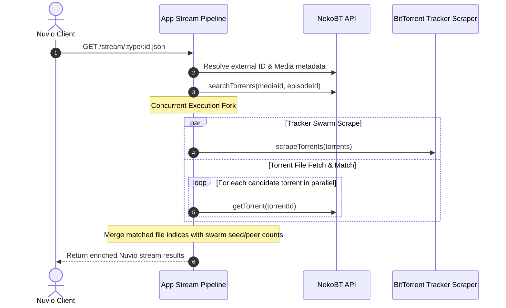

# Decision 004: Pipeline Parallelization for Latency Optimization

**Status:** Accepted  
**Date:** 2026-10-15  
**Amended:** 2026-10-15 — corrected interpretation of the `tt0434665:0:1` row and replaced the original benchmark data with a controlled A/B measurement (same harness, same `nekobt.ts`, back-to-back sessions); the harness now records per-phase timings, rotates endpoint order, and paces requests.

## Context

Nuvio stream requests in Nekuvio previously performed multiple sequential network hops:
1. `getNekoBTExternalId`: Resolves external providers (e.g. Kitsu -> MAL).
2. `resolveMediaId`: Resolves external ID into NekoBT internal media ID.
3. `getMedia`: Retrieves media and episode structure.
4. `searchTorrents`: Fetches candidate torrent listings.
5. `scrapeTorrents`: Contacted BitTorrent trackers over UDP/HTTP in sequence (200–500ms).
6. `torrentToStream`: For every swarm result, sequentially fetched torrent file details (`getTorrent(id)`) from the NekoBT API before matching episode files and building stream payloads.

This serial execution compounded network latency, resulting in stream resolution response times of ~2.0s to 2.7s for popular queries.

## Decision

Parallelize downstream data fetching by concurrently executing tracker swarm scraping (`scrapeTorrents`) and torrent details retrieval (`getTorrent` for all candidate torrents) immediately after candidate torrents are discovered.

### Concurrency Diagram

## Performance Benchmark Data

Latency was measured across 3 representative endpoint queries using the benchmark harness (`test/perf/benchmark.ts`), comparing baseline serial execution against parallelized execution.

The harness reports two things:

- **Phase breakdown**: each pipeline phase (`resolve`, `media`, `search`, `scrape`, `details`) is timed by the harness driving the same modules `streamRequest` uses, so latency can be attributed to a specific phase.
- **Endpoint latency**: wall-clock time of the HTTP request, with the endpoint order rotated every iteration and `BENCH_COOLDOWN_MS` (default 1500 ms) of pacing between every request to avoid rate limiting nekobt.to and tracker endpoints.

### A/B comparison (2026-10-15)

The **baseline** is commit `7c3889d` (serial tail) run in an isolated worktree; the **parallelized** run is commit `22a34c0`. Both used the same harness and the same working-tree `src/api/nekobt.ts` (search limit 30), executed back-to-back with 5 iterations per endpoint, rotated endpoint order, and 1.5 s pacing.

| Endpoint | Baseline Avg (ms) | Baseline Min–Max (ms) | Parallelized Avg (ms) | Parallelized Min–Max (ms) | Δ Avg | Interpretation |
| :--- | :--- | :--- | :--- | :--- | :--- | :--- |
| `/stream/series/kitsu:49235:24.json` | 2,717.1 | 2,509.7–2,937.1 | 2,265.1 | 2,090.5–2,585.0 | **−452.0 ms (−16.6%)** | Tail on the critical path; ranges nearly disjoint |
| `/stream/movie/tt5323662.json` | 1,781.1 | 1,685.6–1,872.5 | 1,609.2 | 1,466.8–1,802.7 | **−171.9 ms (−9.7%)** | Tail saving partially masked by run-to-run noise |
| `/stream/series/tt0434665:0:1.json` | 1,986.9 | 1,753.0–2,261.9 | 2,057.6 | 1,621.2–2,776.8 | +70.7 ms (+3.6%) | Ranges fully overlap — no-op (0 torrents), see Note 2 |

### Phase breakdown

The harness drives the same pipeline modules for both code versions, so the phase table is code-version independent — it predicts what the decision *can* save (parallelized-code session shown; the baseline session agreed within noise: e.g. serial tails 1,225 ms / 889 ms):

| Endpoint | Upstream (resolve+media+search) | Scrape | Details | Serial tail | Parallel tail | Predicted saving | Torrents |
| :--- | :--- | :--- | :--- | :--- | :--- | :--- | :--- |
| `/stream/series/kitsu:49235:24.json` | 1,824 ms | 523 ms | 646 ms | 1,169 ms | 646 ms | ~523 ms | 26 |
| `/stream/movie/tt5323662.json` | 920 ms | 537 ms | 356 ms | 893 ms | 537 ms | ~356 ms | 4 |
| `/stream/series/tt0434665:0:1.json` | 2,233 ms | 0 ms | 0 ms | 0 ms | 0 ms | 0 ms | 0 |

### Notes

1. **Prediction matches measurement.** The phase breakdown predicts a ~523 ms tail saving for the Kitsu query and ~356 ms for the movie; the observed endpoint deltas (−452 ms, −172 ms) have the same sign and order of magnitude, with the remainder attributable to run-to-run variance (the movie's min–max ranges overlap). This is the signature of the decision working exactly as designed: the saving appears only where the serial tail was on the critical path.

2. **`tt0434665:0:1` (season 0 specials) is confirmed a no-op.** Verified 2026-10-15 — `searchTorrents(s2999, episode_ids=117545)` returns **0 candidate torrents** (the media has torrents overall, none for this episode), so both the serial and the parallelized tail complete in ~0 ms and the measured ranges fully overlap (1,753–2,262 ms vs 1,621–2,777 ms). Its ~2 s cost is the always-serial upstream phase (`resolveMediaId` → `getMedia` → `searchTorrents`) that this decision does not modify. The original footnote ("concurrently overlaps tracker wait with API fetches") was incorrect: at 0 candidate torrents there is no tracker wait to overlap; the original table's slower "parallelized" numbers were session noise, not a regression.

3. **Method.** Both versions ran the same harness back-to-back with the same `nekobt.ts`, rotated endpoint order, and paced requests (1.5 s) to avoid rate limiting nekobt.to and tracker endpoints. Live services still vary run to run — compare ranges and phase attribution, not single averages. Reproduce with `npm run benchmark` (`BENCH_ITERATIONS`, `BENCH_COOLDOWN_MS`, `BENCH_PHASE_PASSES` env overrides); the baseline can be re-measured from a worktree at `HEAD~1` with the current harness copied in.