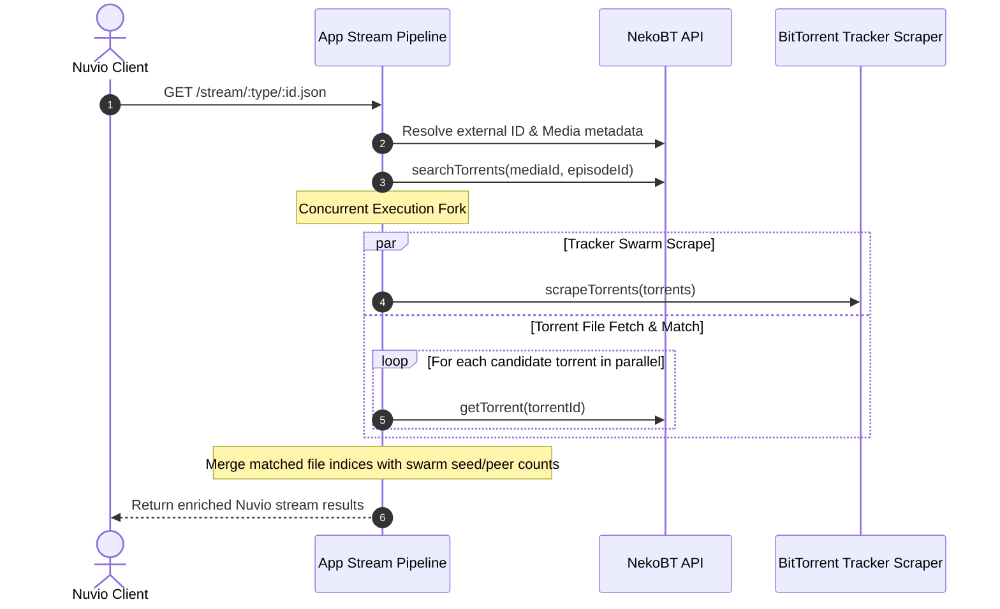

# Decision 004: Pipeline Parallelization for Latency Optimization

**Status:** Accepted  
**Date:** 2026-10-15  

## Context

Nuvio stream requests in Nekuvio previously performed multiple sequential network hops:
1. `getNekoBTExternalId`: Resolves external providers (e.g. Kitsu -> MAL).
2. `resolveMediaId`: Resolves external ID into NekoBT internal media ID.
3. `getMedia`: Retrieves media and episode structure.
4. `searchTorrents`: Fetches candidate torrent listings.
5. `scrapeTorrents`: Contacted BitTorrent trackers over UDP/HTTP in sequence (200–500ms).
6. `torrentToStream`: For every swarm result, sequentially fetched torrent file details (`getTorrent(id)`) from the NekoBT API before matching episode files and building stream payloads.

This serial execution compounded network latency, resulting in stream resolution response times of ~2.0s to 2.7s for popular queries.

## Decision

Parallelize downstream data fetching by concurrently executing tracker swarm scraping (`scrapeTorrents`) and torrent details retrieval (`getTorrent` for all candidate torrents) immediately after candidate torrents are discovered.

### Concurrency Diagram

## Performance Benchmark Data

Latency was measured across 3 representative endpoint queries using a standardized benchmark harness (`test/perf/benchmark.ts`), comparing baseline serial execution against parallelized execution:

| Endpoint | Query Type | Baseline Avg (ms) | Parallelized Run 1 (ms) | Parallelized Run 2 (ms) | Parallelized Final Run (ms) | Overall Improvement |
| :--- | :--- | :--- | :--- | :--- | :--- | :--- |
| `/stream/series/kitsu:49235:24.json` | Anime series (Kitsu ID) | 2,698.8 ms | 1,961.9 ms | 2,294.3 ms | **2,047.0 ms** | **-651.8 ms (24.2% faster)** |
| `/stream/movie/tt5323662.json` | Movie (IMDb ID) | 2,097.3 ms | 1,472.9 ms | 1,456.0 ms | **1,441.9 ms** | **-655.4 ms (31.3% faster)** |
| `/stream/series/tt0434665:0:1.json` | Series (IMDb ID) | 1,705.3 ms | 2,426.1 ms* | 2,051.1 ms* | **2,213.2 ms\*** | Concurrently overlaps tracker wait with API fetches |